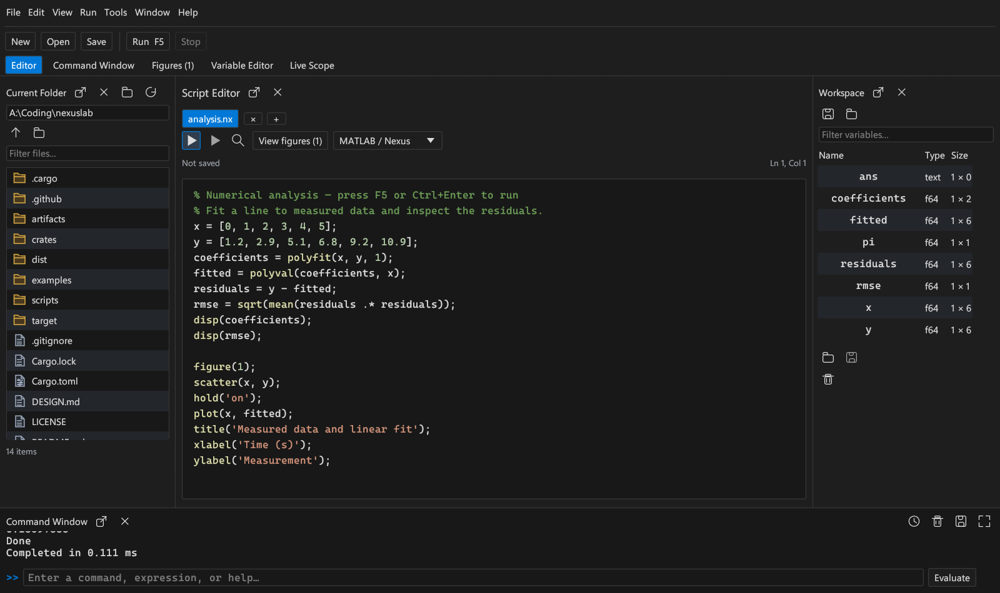
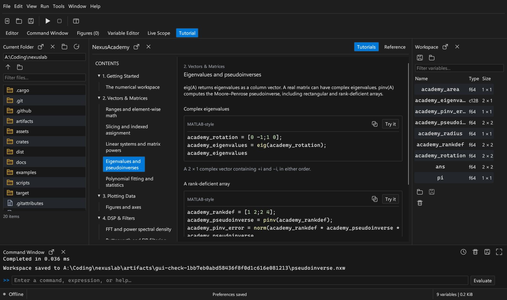

# NexusLab

**An open-source hardware and numerical workbench, built in Rust.**

[](https://github.com/norbertsawe/nexusLab/actions/workflows/ci.yml)
[](LICENSE)

NexusLab brings scripting, numerical analysis, signal processing, and serial
data acquisition into one desktop application. Write an analysis, inspect its
variables, design a filter, and plot the results in the same workspace.



## What you can do

- **Write and run scripts.** Use the tabbed editor or command window, with
  syntax highlighting, completion, command history, and execution timing.
- **Work with data.** Import CSV files, edit arrays, solve linear systems, fit
  polynomials, calculate eigenvalues and pseudoinverses, and save numerical
  workspaces as `.nxw` files.
- **Learn while working.** NexusAcademy includes guided numerical and DSP
  lessons with syntax-highlighted examples you can run directly in your workspace.
- **Analyze signals.** Calculate FFTs and Welch power spectra, design FIR and
  Butterworth IIR filters, and inspect statistical summaries.
- **Explore results.** Pan and zoom plots, read coordinates with the data
  cursor, and export SVG, high-resolution PNG, or complete series as CSV.
- **Connect hardware.** Read serial telemetry or use the built-in signal source
  to test acquisition, triggering, and live spectral analysis.
- **Arrange your workspace.** Detach, dock, or close any panel. Choose a light,
  dark, or system theme and adjust fonts and layout in **Edit → Preferences**.

## Download

The published portable release is **v0.3.0 Pro**. The source tree contains the
**v0.4.0** update with expanded matrix operations and NexusAcademy.
Windows 10/11 x64 is the primary desktop platform.

Download the portable Windows package from [Releases](https://github.com/norbertsawe/nexusLab/releases).
Extract it and run `nexuslab.exe`. The package includes example scripts and a
sample dataset. Windows installer packaging is planned for a subsequent update.

## Build from source

Install stable Rust. On Windows, also install Visual Studio Build Tools with
the **Desktop development with C++** workload and a Windows SDK.

```powershell
git clone https://github.com/norbertsawe/nexusLab.git
cd nexusLab
cargo run --locked --package nexus-gui
```

To build the portable Windows executable:

```powershell
cargo build --release --locked --package nexus-gui --target x86_64-pc-windows-msvc
```

The executable is written to
`target/x86_64-pc-windows-msvc/release/nexuslab.exe`. The release build uses a
static C runtime; Windows system libraries and a graphics driver are required.

Linux and macOS builds are included in CI. Platform prerequisites are covered
in the [user guide](docs/guide.md#start).

## First steps

On a fresh profile, NexusLab opens an example analysis. Press **F5** to fit a
line to measured data and create a figure. Open **Figures** to inspect the
result, or select a workspace variable to view and edit its values.

The command window accepts MATLAB-style numerical expressions:

```matlab
fs = 1000;
t = 0:0.001:1;
x = sin(2*pi*50*t) + 0.2*sin(2*pi*200*t);
sos = butter_lowpass(4, 100, fs);
y = sosfilt(x, sos);
plot(t, y)
```

Use **Tools** for filter design, spectral analysis, and statistics.
**Live Scope** starts the simulated source when no hardware is connected.
Open **Tutorial** for NexusAcademy or use **Help → NexusAcademy**.



NexusLab supports a numerical subset of MATLAB-style syntax. See the
[compatibility reference](docs/compatibility.md) for supported indexing,
matrix operations, and differences from GNU Octave.

| Shortcut | Action |
| --- | --- |
| `Ctrl+N` / `Ctrl+O` | New script / open a file |
| `F5` | Run the current script |
| `F6` | Open or focus the command window |
| `Ctrl+,` | Preferences |
| `Ctrl+Shift+W` | Close all panels |
| `Ctrl+Shift+P` | Restore the workbench |

Closing panels keeps the current session's documents and data. Editor drafts,
history, preferences, and panel layout recover between launches. Use **Save
workspace** to keep numerical variables across sessions.

## Documentation

- [User guide](docs/guide.md): desktop workflow, scripting, hardware, and the local API.
- [Architecture](DESIGN.md): numerical engine, threading, graphics, and implementation limits.
- [Testing](docs/testing.md): development checks and desktop verification.
- [Contributing](CONTRIBUTING.md): reporting issues and submitting changes.

NexusLab supports a numerical subset of M-file syntax and Rhai scripts for
loops and conditionals. The desktop connects serial devices; USB and SCPI
interfaces are available in the hardware library. See the guide for the
supported syntax and device interfaces.

## Project structure

| Crate | Responsibility |
| --- | --- |
| `nexus-core` | Arrays, linear algebra, FFTs, filters, and statistics |
| `nexus-script` | Script evaluation, figures, workspace files, and CSV |
| `nexus-hardware` | Acquisition, serial communication, USB, and SCPI |
| `nexus-gui` | Desktop editor, panels, plots, preferences, and live scope |
| `nexus-cli` | Script runner and local JSON-RPC/MCP services |

## License and maintainer

Maintained by [Norbert John](https://github.com/norbertsawe).
NexusLab is released under the [MIT License](LICENSE).
